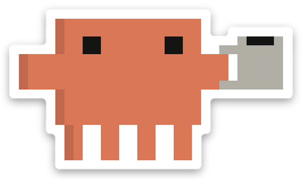

<h1 align="center">
   Claude Toolkit
</h1>

My personal skill stack for Claude — small, reusable skills built from tasks I kept repeating in chat, so I stop re-explaining the same workflow every time.

Each skill lives in `skills/<name>/` with a `SKILL.md` and, where needed, bundled scripts. Pack them into upload-ready `.skill` files and upload to Claude when needed.

## Skills

| Skill | What it does | When to use it |
|---|---|---|
| `skills/svg-optimize/` | Shrinks SVGs with SVGO (multipass, strips metadata/comments, keeps `viewBox`, 2-decimal precision) and render-verifies the result against the original before delivering. Honest about byte targets — says when a target can't be hit without hurting the design. | Drop an `.svg` in chat and ask to optimize, minify, compress, or hit a size target. |
| `skills/favicon-generator/` | Turns one logo (SVG, PNG, JPG, WebP) into a web-ready icon set: multi-resolution `favicon.ico`, PNGs 16–512, `apple-touch-icon-180x180.png`, `android-chrome` 192/512, plus the `<head>` snippet. | Drop a logo in chat and ask for a favicon, site icon, or app icons. |
| `skills/optimize-images/` | Scans a project for raster images, re-encodes them to WebP without visible quality loss (skips SVGs, animated GIFs, existing WebP/AVIF, and files where the result isn't smaller), rewrites references, and generates tiny base64 blur placeholders for smooth blur-up loading. Framework-agnostic (Next.js, React, Vue, Svelte, static HTML). | Ask to optimize/compress project images or add blur-up loading. |
| `skills/copybook-summary/` | Turns textbook chapter pages (screenshots or PDF) into a short, copy-by-hand summary doc: bold key terms to highlight, short lines and symbols, tables for comparisons, drawn diagrams for graphs and flows, worked examples for calculations, and one vocabulary table at the end. Uses the textbook's own numbers and flags anything added. | Send textbook pages and ask for exam revision notes or a copybook summary. |

## Packing `.skill` files

A `.skill` file is a ZIP containing the skill folder — it's what Claude accepts on upload.

```powershell
powershell -ExecutionPolicy Bypass -File package-skills.ps1
```

This packages every skill with a `SKILL.md` into `dist/<name>.skill`. Re-run it after any skill change. `node_modules`, `.git`, and caches are excluded automatically.

To use one: Claude → Skills → Create skill → Upload, then select the `.skill` file.

## Repo layout

```
skills/
  svg-optimize/        SKILL.md + scripts/optimize.sh + scripts/svgo.config.js
  favicon-generator/   SKILL.md + scripts/generate_favicons.py
  optimize-images/     SKILL.md + scripts/optimize-images.mjs + package.json
  copybook-summary/    SKILL.md (instructions only, no scripts)
media/                 header/icon artwork
dist/                  built .skill files (generated, re-build with the script above)
package-skills.ps1     skill → .skill packer
```

## Notes

- Skills are chat-first: `svg-optimize` and `favicon-generator` expect files dropped in chat and deliver to outputs with original filenames preserved.
- `optimize-images` bundles its own `sharp` via its `package.json` — it never adds a dependency to the target project.
- `copybook-summary` is instruction-only: it relies on Claude's doc editor and diagram widgets rather than scripts, so there is nothing to install.

<h1 align="center">
   Make sure to star this repo =D
</h1>
